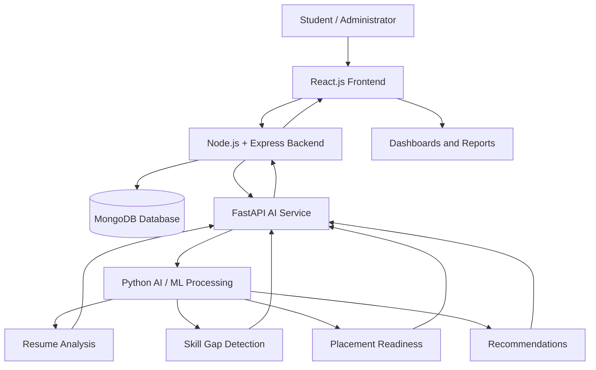
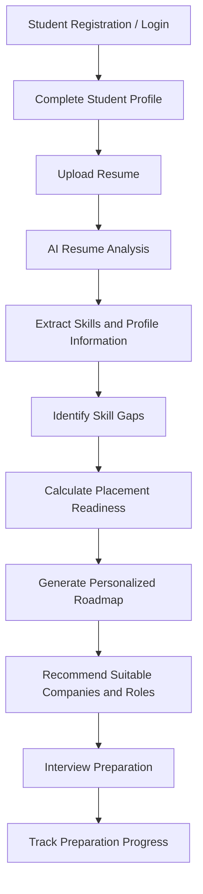

<div align="center">

# 🚀 AI-Powered Placement Preparation Portal

**An Intelligent Platform to Analyze Skills, Predict Placement Readiness, and Guide Students Towards Successful Careers.**

[](https://reactjs.org/)
[](https://nodejs.org/)
[](https://www.mongodb.com/)
[](https://fastapi.tiangolo.com/)
[](https://www.python.org/)

</div>

---

## 📌 Table of Contents

- [💡 Overview](#-overview)
- [❗ Problem Statement](#-problem-statement)
- [💻 Our Solution](#-our-solution)
- [✨ Key Features](#-key-features)
- [🏗️ System Modules](#️-system-modules)
- [🏛️ System Architecture](#️-system-architecture)
- [🛠️ Technology Stack](#️-technology-stack)
- [🔄 Application Workflow](#-application-workflow)
- [⚙️ Installation and Setup](#️-installation-and-setup)
- [🔐 Environment Configuration](#-environment-configuration)
- [🚀 Future Enhancements](#-future-enhancements)
- [👨‍💻 Project Team](#-project-team)
- [🎓 Academic Information](#-academic-information)
- [📚 References](#-references)
- [🤝 Contributing](#-contributing)
- [⭐ Support](#-support)

---

## 💡 Overview

The **AI-Powered Placement Preparation Portal** is an intelligent, web-based platform developed to help students prepare effectively for campus placements and industry recruitment.

Traditional placement preparation often lacks personalized guidance. Students struggle to understand which skills they need, how prepared they are for specific job roles, and what they should learn to improve their chances of getting placed.

Our platform addresses these challenges by combining **Artificial Intelligence**, **Machine Learning**, **Resume Analysis**, and **Data Visualization** to provide personalized placement preparation assistance. The system analyzes student resumes and profiles, identifies relevant technical skills, detects skill gaps, calculates placement readiness scores, and generates personalized learning recommendations alongside company-role matching and interview support.

> **🎯 Our Vision:** To bridge the gap between academic learning and industry expectations by making placement preparation smarter, personalized, and data-driven.

---

## ❗ Problem Statement

Many students face difficulties during placement preparation due to the following challenges:

- ❌ Lack of personalized placement preparation guidance.
- ❌ Difficulty identifying industry-required technical skills.
- ❌ Manual resume evaluation and skill assessment.
- ❌ No clear understanding of individual placement readiness.
- ❌ Difficulty identifying skill gaps for specific job roles.
- ❌ Lack of structured learning roadmaps.
- ❌ Limited visibility into suitable companies and career opportunities.

**The Result:** Students often prepare blindly without knowing what they actually need to improve.

---

## 💻 Our Solution

We developed an AI-powered platform that transforms traditional placement preparation into a personalized and data-driven process. Instead of providing generic preparation resources, our platform evaluates individual student profiles and provides actionable insights.

| Challenge | Our AI-Powered Solution |
| :--- | :--- |
| **Manual resume analysis** | 🤖 AI-powered automated resume parsing |
| **Unknown skill gaps** | 🎯 Automated skill-gap identification |
| **Unclear placement readiness** | 📊 Data-driven placement readiness scoring |
| **Generic learning resources** | 🗺️ Personalized learning roadmaps |
| **Difficulty choosing companies** | 🏢 Intelligent company and job-role matching |
| **Lack of preparation insights** | 📈 Interactive visual dashboards and reports |

---

## ✨ Key Features

1. **📄 AI-Based Resume Analysis**
   - Upload and parse student resumes automatically.
   - Extract relevant technical skills and educational background.
   - Identify projects, internships, experience, and profile details to generate structured student profiles.

2. **🎯 Skill Gap Detection**
   - Map existing student skills against target job-role requirements.
   - Highlight missing or insufficient competencies so students know exactly what to improve.

3. **📊 Placement Readiness Score**
   - Evaluate student profiles using key placement parameters (skills, projects, CGPA, and internships).
   - Generate an actionable placement readiness score to benchmark preparation levels.

4. **🗺️ Personalized Learning Roadmap**
   - Recommend high-priority skills students should develop next.
   - Provide structured, step-by-step learning guidance for continuous improvement.

5. **🏢 Company and Job-Role Matching**
   - Maintain a centralized repository of company profiles and job-role criteria.
   - Match student capabilities with suitable career opportunities and industry expectations.

6. **🎤 Mock Interview Support**
   - Provide targeted technical and placement-oriented interview practice.
   - Help students build confidence for real-world recruitment rounds.

7. **📈 Interactive Dashboards**
   - **Student Dashboard:** Visual representation of readiness scores, skill gaps, and roadmap progress.
   - **Admin Dashboard:** Comprehensive analytics and placement management tools for coordinators.

---

## 🏗️ System Modules

The application is organized into three major functional modules:

### 👨‍🎓 1. Student Module
Provides students with end-to-end tools required for placement preparation:
- Student registration and secure login
- Resume upload and automated analysis
- Skill profile management
- Placement readiness reports & skill-gap analysis
- Personalized learning roadmaps & company-role recommendations
- Interview preparation support

### 🛡️ 2. Admin / Placement Cell Module
Allows administrators and placement coordinators to manage campus recruitment data:
- Manage student records and profiles
- Manage company profiles and job roles
- Define required technical skills for specific job roles
- Access batch-wide student analytics and monitor preparation progress

### 🧠 3. AI / Machine Learning Module
Acts as the core intelligence layer of the application:
- Automated resume parsing and skill extraction
- Skill-gap identification engine
- Predictive placement readiness analysis
- Personalized roadmap recommendation and AI interview assistance

---

## 🏛️ System Architecture

The application follows a modular client-server architecture decoupled with a dedicated Python AI microservice:



### Architecture Breakdown
1. **Frontend Layer (`React.js`):** Provides a responsive, interactive UI for students and administrators.
2. **Backend Layer (`Node.js` & `Express.js`):** Handles core application logic, authentication, REST APIs, and inter-service orchestration.
3. **Database Layer (`MongoDB`):** Stores student profiles, company details, job roles, and analytics data.
4. **AI Service Layer (`FastAPI`):** Exposes high-performance asynchronous endpoints for AI/ML tasks.
5. **Machine Learning Layer (`Python`):** Executes NLP resume parsing, skill matching, readiness scoring, and recommendation algorithms.

---

## 🛠️ Technology Stack

| Layer | Technologies | Purpose |
| :--- | :--- | :--- |
| **Frontend** | React.js, React Router | Dynamic, component-based user interface and navigation |
| **API & Visualization** | Axios, Recharts | Seamless HTTP requests and interactive analytics charts |
| **Backend** | Node.js, Express.js | Scalable RESTful APIs and server-side business logic |
| **Database** | MongoDB, Mongoose | Flexible NoSQL document storage and schema modeling |
| **AI Backend** | Python, FastAPI | Dedicated, high-speed microservice for AI inference |
| **AI / ML** | Python ML/NLP Libraries | Resume parsing, skill extraction, and readiness prediction |
| **Dev Tools** | VS Code, Git, GitHub | Development environment and version control |

---

## 🔄 Application Workflow



### Step-by-Step Flow
1. **Onboarding:** Students register, log in, and complete their academic profile.
2. **Resume Upload:** Students upload their resume to the portal.
3. **AI Extraction:** The FastAPI service parses the document and extracts skills, projects, and experience.
4. **Gap & Readiness Evaluation:** The system compares extracted data against industry benchmarks to detect skill gaps and compute a readiness score.
5. **Actionable Guidance:** Students receive a tailored learning roadmap, matched company roles, and mock interview practice.

---

## ⚙️ Installation and Setup

Follow these steps to set up and run the project locally.

### Prerequisites
Ensure the following tools are installed on your machine:
- **Node.js** (v18+) and **npm**
- **Python** (3.10+)
- **MongoDB** (Local instance or MongoDB Atlas URI)
- **Git**

### 1. Clone the Repository
```bash
git clone [https://github.com/YOUR_USERNAME/YOUR_REPOSITORY_NAME.git](https://github.com/YOUR_USERNAME/YOUR_REPOSITORY_NAME.git)
cd YOUR_REPOSITORY_NAME
```

### 2. Frontend Setup
```bash
cd frontend
npm install
npm run dev
```

### 3. Backend Setup
```bash
cd backend
npm install
npm start
```

### 4. AI Service Setup
```bash
cd ai-service

# Create a virtual environment
python -m venv venv

# Activate virtual environment (Windows)
venv\Scripts\activate

# Activate virtual environment (Linux / macOS)
source venv/bin/activate

# Install Python dependencies
pip install -r requirements.txt

# Start the FastAPI server
uvicorn main:app --reload
```
> **API Docs:** Once running, interactive FastAPI Swagger documentation is available at `http://127.0.0.1:8000/docs`.

*(Note: Adjust directory names, entry points, and npm scripts if your local folder structure differs.)*

---

## 🔐 Environment Configuration

Create `.env` files in your respective service directories (`backend/.env` and `frontend/.env`) using the template below:

```env
# Backend Configuration (backend/.env)
PORT=5000
MONGODB_URI=your_mongodb_connection_string
AI_SERVICE_URL=[http://127.0.0.1:8000](http://127.0.0.1:8000)

# Frontend Configuration (frontend/.env)
VITE_API_URL=http://localhost:5000
```

> ⚠️ **Security Note:** Never commit `.env` files, API keys, or database credentials to GitHub. Ensure `.env` is listed in your `.gitignore` file and provide an `.env.example` template instead.

---

## 🚀 Future Enhancements

- [ ] **Advanced Resume Scoring:** Deep semantic evaluation and ATS formatting feedback.
- [ ] **Live Job Portal Integration:** Real-time job listings fetched from external recruitment APIs.
- [ ] **Company-Specific Prediction:** Predictive modeling tailored to historical hiring patterns of specific recruiters.
- [ ] **AI Video/Audio Interview Simulator:** Real-time speech, sentiment, and technical answer analysis.
- [ ] **Course & Certification Engine:** Direct links to curated courses mapped to identified skill gaps.
- [ ] **Automated Alerts:** Email and push notifications for placement drives and milestones.

---

## 👨‍💻 Project Team

Developed by students of the **Artificial Intelligence and Machine Learning Department**:

| Team Member | Roll Number |
| :--- | :---: |
| **Sainath Fagare** | `A11` |
| **Sanskar Gurav** | `A14` |
| **Samarth Kumbhar** | `A31` |
| **Parmeshwar Shelke** | `A38` |

---

## 🎓 Academic Information

- **Project Title:** AI-Powered Placement Preparation Portal
- **Institution:** KIT's College of Engineering, Kolhapur
- **Department:** Artificial Intelligence and Machine Learning
- **Project Guide:** Dr. Pradeep Khot
- **Project Domain:** Artificial Intelligence, Machine Learning, Full-Stack Web Development

---

## 📚 References

1. *Resume – General Overview & Standard Structuring Guidelines*
2. *Placement Prediction and Analysis Using Machine Learning* – International Journal of Engineering Research & Technology (IJERT)
3. *Campus Placement Prediction Using Machine Learning* – International Journal of Intelligent Systems and Applications in Engineering (IJISAE)

---

## 🤝 Contributing

Contributions, suggestions, and improvements are always welcome!

1. **Fork** the repository.
2. Create a new feature branch (`git checkout -b feature/AmazingFeature`).
3. **Commit** your changes (`git commit -m 'Add some AmazingFeature'`).
4. **Push** to the branch (`git push origin feature/AmazingFeature`).
5. Open a **Pull Request**.

---

## ⭐ Support

If you find this project helpful or interesting, please consider giving this repository a **⭐ Star** on GitHub! Your support motivates us to continue building innovative solutions using AI and Machine Learning.

<div align="center">
  <br />
  <p><strong>Bridging the Gap Between Academic Learning and Industry Expectations.</strong></p>
  <p>Made with ❤️ by <strong>Team AI & ML</strong></p>
</div>
